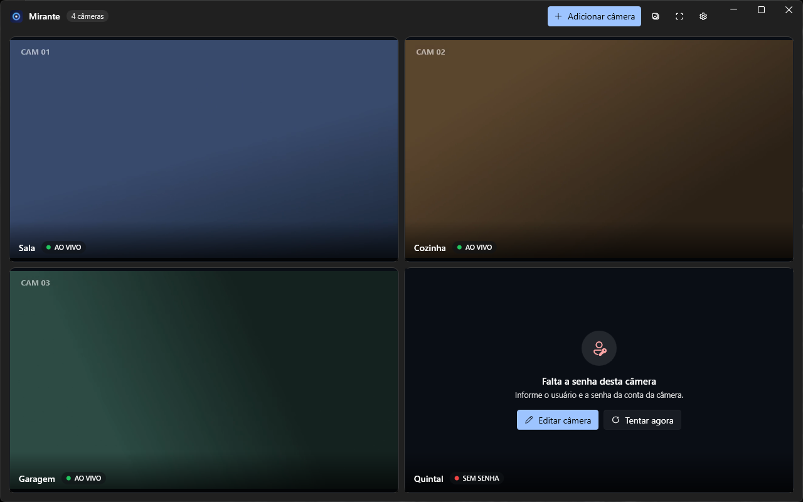

<p align="center">
  
</p>

<h1 align="center">Mirante</h1>

<p align="center">
  Your home cameras, live and side by side, right on your PC.<br/>
  No cloud, no account, no telemetry.
</p>

<p align="center">
  <b>English</b> · <a href="README.pt-BR.md">Português</a>
</p>

<p align="center">
  
</p>

> **Status:** 0.x, first public releases. Get the installer from [Releases](https://github.com/sanfado/mirante/releases).
> The interface is in Brazilian Portuguese for now; English is on the [roadmap](docs/ROADMAP.md).

## Features

- **Automatic mosaic** that makes the most of the screen (on a portrait monitor, cameras stack).
- **Pop out a camera** into its own window, in the same app, to put each camera on a different monitor.
- **Remembers the layout**: on reopen, each popped-out camera returns to the same monitor, fullscreen included.
- **Fullscreen on the monitor the window is on** (F11), not on the primary monitor.
- **Focus**: double-click or keys `1`–`9` to show one camera large; `Esc` goes back.
- **Audio**: a sound button per camera, one playing at a time; volume up to 200% and "voice boost" (speech EQ), saved per camera.
- **Move the camera (PTZ)**: on ONVIF cameras (such as Tapo C200/C210), arrows on the video and on the keyboard; zoom and diagonal moves on cameras that support them.
- **Snapshots** (`F` or the camera's button) saved locally to `Pictures\Mirante`, outside OneDrive.
- **Automatic reconnection** with diagnosis: tells "password rejected" apart from "camera offline".
- **Connection test** when adding a camera: checks IP, port and password before saving.
- **No-surprise updates**: new versions download in the background and a button appears; nothing installs until you click.
- **Tray and startup**: can start with Windows and sit by the clock without spending CPU on video.
- GPU decoding (LibVLC), Windows 11 Fluent interface with dark/light theme.

Built with **TP-Link Tapo** cameras in mind (RTSP `stream1`/`stream2`) and compatible with RTSP cameras in
general (Intelbras, Hikvision, Dahua, Reolink…) in H.264, H.265 or MJPEG.

PTZ control uses ONVIF and shows up by itself when the camera offers it. It was tested on real
hardware with a Tapo C210; diagonal moves and zoom follow the ONVIF standard and were tested
against a simulated camera only. If you try another model, please report back in an
[issue](https://github.com/sanfado/mirante/issues).

## Install

Download `Mirante-win-Setup.exe` from [Releases](https://github.com/sanfado/mirante/releases) and run it.
It installs for your user only (no admin rights), creates shortcuts and installs the .NET Desktop Runtime 10 if missing.
The installer is not code-signed yet, so Windows may warn about an "unknown publisher".
Uninstall from **Windows Settings › Apps**.

## Security and privacy

- Passwords live in the **Windows Credential Manager** (DPAPI), never in the app's files.
- RTSP URLs are built **without credentials**; user and password reach the video engine as separate options and never show up in logs.
- LibVLC runs with `--ignore-config` and `--keystore=memory`: it doesn't read an installed VLC's settings nor store passwords on disk. Only the VLC plugins the app needs are shipped (RTSP, decoding, audio, video, snapshots): no Lua, encoders, DVD, subtitles or streaming output.
- Configuration is validated on load (a tampered file can't inject arbitrary URLs) and written atomically.
- No servers, open ports, accounts or telemetry. The app talks to the cameras you add and, if enabled (default), to GitHub to look for new Mirante versions. None of your data is sent.
- Uninstalling deletes the camera passwords from the Credential Manager and removes the startup entry.
- Locked package versions (`packages.lock.json`), NuGet vulnerability audit on every build, Dependabot.

Details and limitations (RTSP is not encrypted) in [SECURITY.md](SECURITY.md).

## Shortcuts

| Key | Action |
|---|---|
| `F11` | Fullscreen on the current monitor |
| `Esc` | Leave fullscreen / focus |
| `1`–`9` / `0` | Focus camera N / back to the mosaic |
| `M` | Toggle the camera's sound |
| Arrows / `+` `−` | Move the camera and zoom (with "Mover câmera" on) |
| `F` | Snapshot of the camera under the mouse |
| `Ctrl+N` | Add camera |
| Double-click | Focus the camera (in a popped-out window: fullscreen) |

## Development

Requirements: Windows 10/11 x64 and .NET SDK 10.

```bash
dotnet build
dotnet test --project tests/Mirante.Core.Tests
dotnet run --project src/Mirante.App
./build/pack.ps1 -Version 0.1.0   # installer (Velopack) in artifacts/releases
```

**Releasing:** `git tag v0.2.0 && git push origin v0.2.0`. The `Release` workflow tests, builds the installer
(with delta updates from previous versions) and publishes to GitHub Releases, where installed apps update from.

Demo mode (Debug builds only), with local videos instead of cameras and automatic screenshots:

```bash
dotnet run --project src/Mirante.App -- --demo <folder-with-mp4> <screenshots-folder>
```

### Layout

```
src/Mirante.Core     UI-free logic: cameras, validation, RTSP (login test), credentials, layout, persistence
src/Mirante.App      WPF app (WPF-UI + LibVLCSharp): windows, video tiles, reconnection, audio, updates
tests/               Tests (xUnit v3), including a fake RTSP camera and the real Credential Manager
build/               Packaging (Velopack) and installer art
docs/                Roadmap, architecture decisions (ADR) and screenshots
```

Stack decision: [docs/adr/0001-stack.md](docs/adr/0001-stack.md).

## License

[MIT](LICENSE) © 2026 Sanfado. The installer bundles third-party components under their own licenses
(LibVLC/FFmpeg under LGPL, WPF-UI, Velopack, etc.): see [THIRD-PARTY-NOTICES.md](THIRD-PARTY-NOTICES.md).
